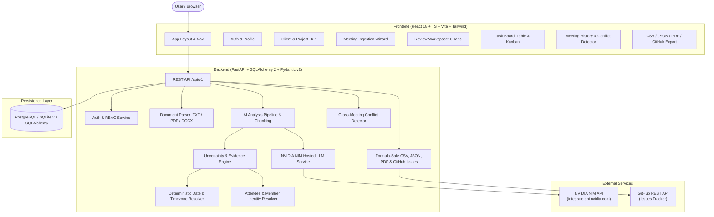

# MeetFlow AI — Client Meeting-to-Action Tracker

> Enterprise-grade web application converting client meeting transcripts and notes into structured, traceable, editable meeting outcomes: Decisions, Tasks, Owners, Due Dates, Risks, Dependencies, and Unanswered Questions — powered by hosted **NVIDIA NIM** LLMs.

[](https://github.com/your-username/meetflow-ai/actions)
[](LICENSE)
[](https://www.python.org/downloads/)
[](https://react.dev/)
[](https://fastapi.tiangolo.com/)

---

## 1. Problem Statement & Value Proposition

Consultants, project managers, account executives, and business analysts routinely spend hours reviewing unstructured meeting recordings and transcripts to assemble action item lists. Standard AI summarizers often hallucinate commitments, fabricate deadlines, and assign tasks to whoever happened to speak the sentence.

**MeetFlow AI** solves this by strictly enforcing a non-negotiable principle: **Preserve Uncertainty**. The system never invents an owner, deadline, decision, or fact that was not directly stated or supported by source evidence.

---

## 2. Key Features

- **Document Ingestion & Parsing**: Upload TXT, PDF, and DOCX files or paste unstructured text. Automatically detects speaker labels and handles scanned/unreadable documents gracefully.
- **Hosted NVIDIA NIM LLM Integration**: Production inference using real hosted NVIDIA NIM models (e.g. `meta/llama-3.3-70b-instruct`) via the official OpenAI-compatible endpoint.
- **Strict Uncertainty Preservation**:
  - **Owners**: Distinguishes `explicit`, `user_confirmed`, `not_stated`, `ambiguous`, and `conflicting`.
  - **Deadlines**: Distinguishes `explicit`, `resolved_from_meeting_date`, `user_confirmed`, `not_stated`, `ambiguous`, and `conflicting`.
  - **Decisions vs Proposals**: Tentative suggestions are flagged as `proposed`, preventing premature commitment.
- **Evidence Traceability & Offsets**: Every extracted outcome links back to its exact source sentence and character offsets. Click any evidence quote in the review workspace to jump directly to the highlighted text in the transcript.
- **6-Tab Review Workspace**:
  1. *Overview*: Executive summary, discussion topics, KPI counters, and data uncertainty warnings.
  2. *Decisions*: Status badges, approvers, source evidence, confirm/reject/supersede workflows.
  3. *Action Items*: Tasks with certainty indicators, priority, inline confirm/assign actions.
  4. *Risks & Blockers*: Impact, likelihood, mitigations, and resolution questions.
  5. *Questions*: Unanswered clarification questions with inline team resolution forms.
  6. *Transcript*: Complete searchable transcript with speaker labels and click-to-highlight source passages.
- **Task Management Board**: Dual-view interface with filterable Table and Kanban board.
- **Meeting-to-Meeting Tracking & Contradiction Detector**: Detects cross-meeting conflicts (e.g., date changes or contradictory decisions across multiple project meetings) without arbitrarily overwriting earlier commitments.
- **Multi-Format & External Exports**:
  - Formula-injection protected CSV (`=`, `+`, `-`, `@` escaped).
  - Versioned structured JSON.
  - Executive Markdown Brief.
  - Printable PDF Report (generated via ReportLab).
  - GitHub Issues Task Tracker integration with pre-flight uncertainty checks and duplicate export prevention.
- **Role-Based Access Control (RBAC)**: Enforced backend security with `admin`, `project_manager`, `member`, and `viewer` roles.

---

## 3. Architecture



---

## 4. Technology Stack

- **Frontend**: React 18, TypeScript, Vite, Tailwind CSS, TanStack Query, Lucide Icons, Vitest.
- **Backend**: Python 3.11+, FastAPI, Pydantic v2, SQLAlchemy 2.0 (async), Alembic, PyPDF, Python-docx, ReportLab, Pytest.
- **Database**: PostgreSQL (Production) / SQLite with aiosqlite (Local Dev & Testing).
- **Inference**: NVIDIA NIM API (`https://integrate.api.nvidia.com/v1`).
- **CI/CD**: GitHub Actions, Docker Compose.

---

## 5. Local Setup Instructions (macOS Apple Silicon & Linux)

### Prerequisites
- Python 3.11+
- Node.js 18+ & npm
- Git

### 1. Clone & Set Up Repository
```bash
git clone https://github.com/your-username/meetflow-ai.git
cd meetflow-ai
```

### 2. Configure Environment
```bash
cp .env.example .env
```
Edit `.env` and configure your NVIDIA NIM API key:
```ini
NVIDIA_API_KEY=your_real_nvidia_nim_key_here
NVIDIA_BASE_URL=https://integrate.api.nvidia.com/v1
NVIDIA_MODEL=meta/llama-3.3-70b-instruct
```

### 3. Backend Setup
```bash
# Create and activate virtual environment
python3 -m venv .venv
source .venv/bin/activate

# Install dependencies
pip install -r backend/requirements.txt

# Run database migrations
alembic -c backend/alembic.ini upgrade head

# (Optional) Seed demo data with sample clients, meetings, and users
python backend/scripts/seed_data.py
```

### 4. Frontend Setup
```bash
cd frontend
npm install
cd ..
```

---

## 6. Running the Application

### Option A: Local Development
```bash
# Terminal 1: Backend
source .venv/bin/activate
cd backend
python -m uvicorn backend.app.main:app --host 0.0.0.0 --port 8000 --reload

# Terminal 2: Frontend
cd frontend
npm run dev
```
Open [http://localhost:5173](http://localhost:5173) in your browser.

### Option B: Docker Compose
```bash
docker compose up --build
```

---

## 7. Default Demo Accounts

If you ran `python backend/scripts/seed_data.py`, use any of these pre-configured accounts:

| Role | Email | Password | Access Level |
|---|---|---|---|
| **Admin** | `admin@acme.com` | `AdminPass123!` | Full workspace administration |
| **Project Manager** | `pm@acme.com` | `PMPass123!` | Meeting analysis, outcome approval, task exports |
| **Member** | `member@acme.com` | `MemberPass123!` | View projects, edit assigned tasks, answer questions |
| **Viewer** | `viewer@acme.com` | `ViewerPass123!` | Read-only access to authorized records |

---

## 8. Automated Tests & Adversarial Verification

Run the full automated test suite (including Scenarios A through H):

```bash
# Backend pytest suite (24 tests: auth, RBAC, CRUD, LLM, exports, Scenarios A-H)
source .venv/bin/activate
PYTHONPATH=. pytest -v backend/tests

# Frontend Vitest suite
cd frontend
npm test -- --run
```

### Adversarial Uncertainty Scenarios Verified:
- **Scenario A (No owner stated)**: Task extracted with `owner=null`, `owner_status=not_stated`, confirmation required.
- **Scenario B (No deadline stated)**: Task extracted with owner assigned, but `due_date=null`, `due_date_status=not_stated`, no default deadline created.
- **Scenario C (Ambiguous relative deadline)**: Preserves original phrase; resolves only if meeting date and timezone are known.
- **Scenario D (Tentative decision)**: Proposals marked as `proposed`, preventing false confirmed decisions.
- **Scenario E (Conflicting commitments)**: Cross-meeting conflict detector flags discrepancy and asks for user confirmation.
- **Scenario F (Ambiguous identity)**: Name matching multiple attendees flags `OwnerStatus.AMBIGUOUS`.
- **Scenario G (Malicious transcript prompt injection)**: Transcripts treated as untrusted user speech; injection attempts cannot escalate privileges or execute commands.
- **Scenario H (NVIDIA unavailable)**: Real failure state reported; source transcript preserved; retry allowed without fake output.

---

## 9. API Documentation

Interactive OpenAPI / Swagger documentation is available at:
`http://localhost:8000/docs`

Key endpoint groups:
- `/api/v1/auth`: Registration, JWT login, profile.
- `/api/v1/clients`: Client management.
- `/api/v1/projects`: Project workspaces, timeline, conflict detector.
- `/api/v1/meetings`: Transcript upload (TXT, PDF, DOCX), NVIDIA analysis, review workspace.
- `/api/v1/decisions`: Decisions register and confirmation.
- `/api/v1/tasks`: Task board, owner confirmation, due date confirmation, comments.
- `/api/v1/risks` & `/api/v1/questions`: Risks and clarification questions.
- `/api/v1/exports`: CSV, JSON, Markdown, PDF, and GitHub Issues sync.
- `/api/v1/dashboard`: Real database-backed analytics and metrics.
- `/api/v1/system`: Health checks and AI provider status.

---

## 10. License

This project is licensed under the MIT License — see the [LICENSE](LICENSE) file for details.

